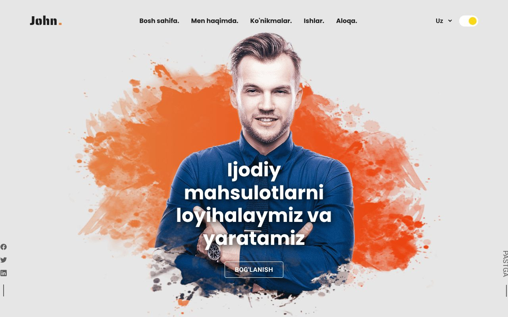

<div align="center">

# portfolio-v1

**🇺🇿 O'zbekcha** · [🇬🇧 English](#-english) · [🇷🇺 Русский](#-русский)



**[➥ Live demo](https://abdullohkhan.github.io/portfolio-builder/v1/)**

</div>

## 🇺🇿 O'zbekcha

To'liq responsive, 3 tilli (o'zbek, ingliz, rus) va dark/light rejimli shaxsiy portfolio sayti. HTML, CSS va JavaScript'da yozilgan, hech qanday build talab qilinmaydi.

**Imkoniyatlar**
- Til almashtirgich (Uz / En / Ru) — tanlov brauzerda saqlanadi
- Dark / light rejim — birinchi kirishda tizim sozlamasiga moslashadi
- Barcha qurilmalarga moslashuvchan (telefon, planshet, desktop)
- Demo kontakt forma — xabar hech qayerga yuborilmaydi

**Ishga tushirish**

```bash
npx serve .
```

yoki `index.html` ni brauzerda oching.

> Bu demo portfolio: ism (John Doe), telefon, email va manzil — namunaviy ma'lumotlar.

Ishlab chiqdi: [t.me/Abdulloh_77700](https://t.me/Abdulloh_77700)

---

## 🇬🇧 English

A fully responsive personal portfolio website in 3 languages (Uzbek, English, Russian) with dark/light mode. Built with plain HTML, CSS and JavaScript — no build step needed.

**Features**
- Language switcher (Uz / En / Ru), saved in the browser
- Dark / light mode, follows the system setting on first visit
- Responsive on phones, tablets and desktops
- Demo contact form — messages are not sent anywhere

**Run locally**

```bash
npx serve .
```

or open `index.html` in a browser.

> This is a demo portfolio: the name (John Doe), phone, email and address are placeholders.

Developed by [t.me/Abdulloh_77700](https://t.me/Abdulloh_77700)

---

## 🇷🇺 Русский

Полностью адаптивный сайт-портфолио на 3 языках (узбекский, английский, русский) с тёмной и светлой темой. Написан на HTML, CSS и JavaScript — сборка не нужна.

**Возможности**
- Переключатель языка (Uz / En / Ru), выбор сохраняется в браузере
- Тёмная / светлая тема, при первом визите — по настройкам системы
- Адаптивность для телефонов, планшетов и компьютеров
- Демо-форма обратной связи — сообщения никуда не отправляются

**Запуск**

```bash
npx serve .
```

или откройте `index.html` в браузере.

> Это демо-портфолио: имя (John Doe), телефон, email и адрес — примеры.

Разработчик: [t.me/Abdulloh_77700](https://t.me/Abdulloh_77700)
